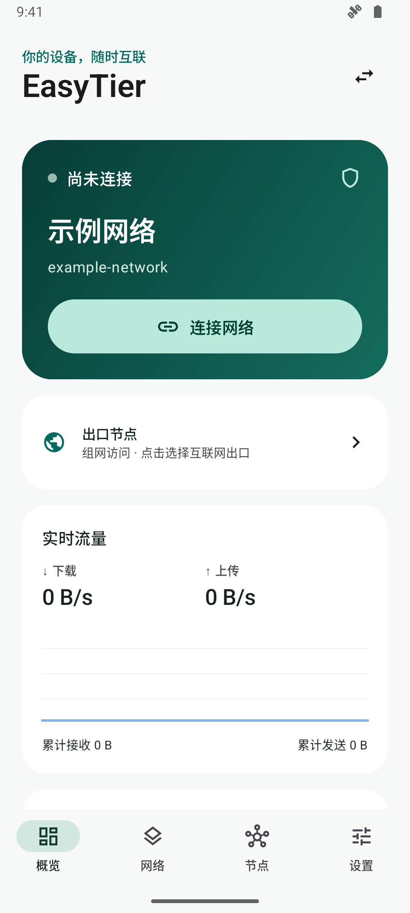
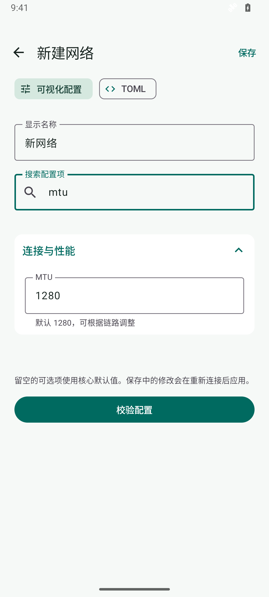
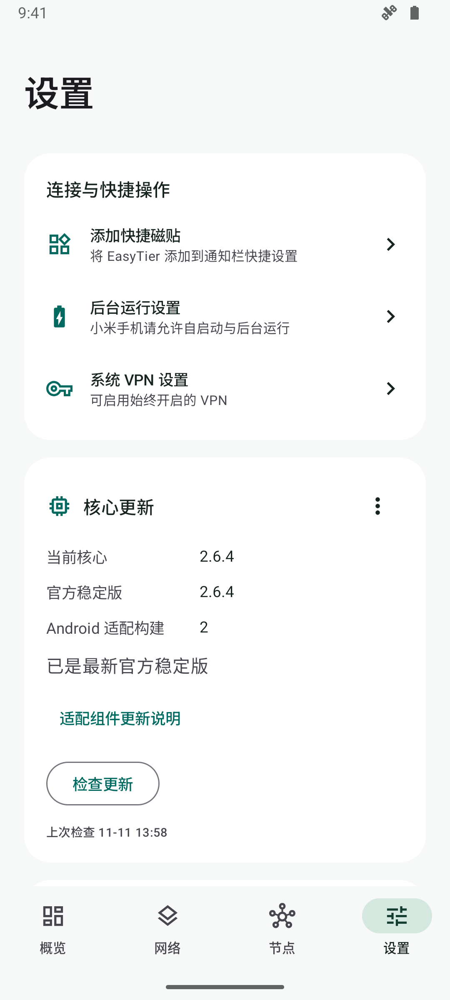
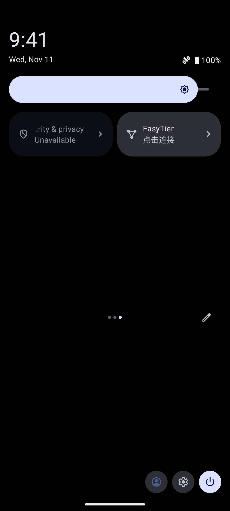

# EasyTier Android

原生 Android EasyTier 客户端，使用 Kotlin、Jetpack Compose Material 3 与官方 Rust 核心。

## 功能

- Android VPN 前台服务与快捷设置磁贴。
- 多配置保存、复制、导入导出和 TOML 编辑。
- 网络身份、初始节点、监听、路由、出口节点和 DNS 设置。
- 节点连接类型、延迟、丢包、实时速率、累计流量和事件日志。
- ACL、SOCKS5、端口转发、WireGuard 门户、远程 RPC 管理和配置服务器。
- 浅色、深色与跟随系统主题。
- 官方稳定版检查、独立适配组件更新、签名验证和更新后重连。

## 界面截图

截图来自 Android 模拟器，使用 `examples/phone.toml` 中的通用示例配置。

| 概览 | 可视化配置 |
| --- | --- |
|  |  |
| 设置与核心更新 | 关闭状态的快捷磁贴 |
|  |  |

## 安装与使用

从 Releases 下载与设备架构匹配的 APK，ARM64 使用 `arm64-v8a`，32 位 ARMv7 使用 `armeabi-v7a`，64 位 x86 设备与模拟器使用 `x86_64`。安装后在“网络”页面导入 TOML 或新建配置，允许系统 VPN 授权和通知权限。快捷磁贴入口位于设置页顶部，连接状态变化时实时更新高亮，长按磁贴打开应用界面。[下载安装包](https://github.com/sw1313/easytier-android/releases/latest)

首页“出口节点”可以选择互联网出口并设置 DNS。出口设备需要配置 EasyTier 的 `enable_exit_node`、系统转发和源 NAT。当前出口通道提供 IPv4 互联网出口，IPv6 默认路由由 VPN 管理。

示例配置采用保留示例域名与通用私有网段，使用时填写自己的节点与网络身份。[示例配置](examples/phone.toml)

可视化保存会重新排版 TOML 并移除注释。Android 的 VPN 接口对应当前选中的网络，配置服务器下发的其他实例由核心管理。

## 核心更新

设置页按官方稳定版检查更新，官方核心版本和 Android 适配构建号分开展示。兼容包可用后可以下载、校验并重新启动应用，随后恢复原来的连接与出口设置。[核心更新说明](docs/UPDATES.md)

## 源码与构建

最低 Android 8.0，目标 Android 15。开发环境使用 JDK 17、Android SDK 35、NDK 29.0.14206865、Rust 1.95.0 和 Gradle Wrapper 8.11.1。

```powershell
git clone --recurse-submodules https://github.com/sw1313/easytier-android.git
cd easytier-android
./build-native.ps1 -Architecture aarch64
./gradlew.bat :app:assembleDebug -Pabi=arm64-v8a
```

核心源码通过固定版本的官方子模块管理。完整源码发行包包含对应的核心源码。[构建说明](docs/BUILD.md)

## 发布与校验

运行配置存储在应用私有目录。发布者在本地持有签名材料，应用与源码提供用于验证核心更新的公钥。

已验证的功能包括配置往返、密钥字段隐藏、持久化、VPN 数据传输、磁贴重连、远程 RPC、配置服务器、安全更新目录、下载校验和独立核心加载。VPN 生命周期回归同时检查核心停止与 Android 系统 VPN 网络消失。测试使用示例与本机回环环境。

长时间后台运行与移动网络切换需要结合设备系统的后台策略验证。

## 许可证

项目采用 LGPL-3.0，使用 EasyTier 官方核心。[许可证](LICENSE) · [项目来源](NOTICE.md) · [更新记录](CHANGELOG.md)
