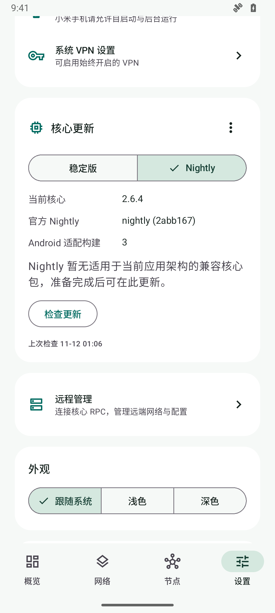
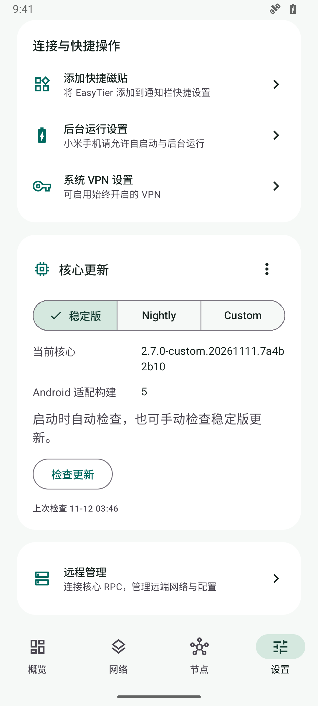
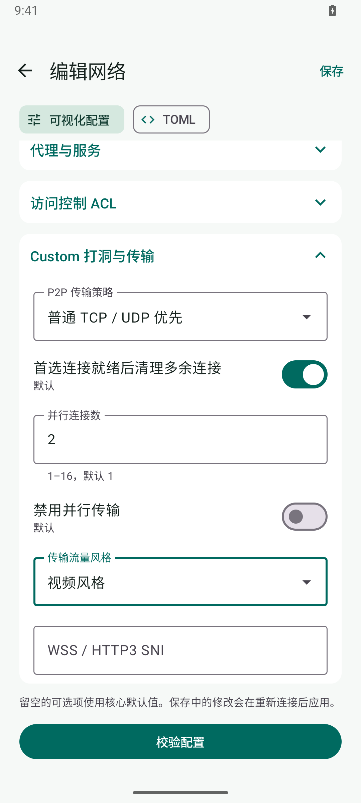

# 核心更新

## 版本显示

应用分别显示核心版本和 Android 适配构建号。

- `2.6.4` 表示官方 EasyTier 核心版本。
- 适配构建 `3` 表示 Android JNI 与打包层的构建编号。
- `2.6.4-md3` 是签名包内部标识。

官方版本提升时显示“下载核心更新”。同一官方版本的适配构建提升时显示“更新适配组件”。默认检查官方稳定版，兼容包准备状态会显示在应用中。

## 更新通道

在“设置 → 核心更新”选择“稳定版”、“Nightly”或“Custom”。切换后保存选择并立即检查，各通道独立记录检查时间。

- 稳定版读取官方最新稳定 Release 和本仓库 `updates/stable.json`。
- Nightly 读取官方滚动 `nightly` Release 的提交信息和本仓库 `updates/nightly.json`。
- Custom 读取 EasyTier-Custom 最新成功的 main 分支核心构建提交和本仓库 `updates/custom.json`。首次使用需要应用 1.2.8 或更高版本。
- 所选通道决定后续检查的更新源。兼容包下载、校验完成后，可通过“应用并重启”加载。
- 返回稳定版时可以下载稳定核心，即使其版本号低于当前 Nightly 或 Custom。

Nightly 与 Custom 从各自签名目录选择最新可下载的兼容包。筛选条件包括 JNI API、应用最低版本、Android 版本与当前应用进程架构。最新候选包无法下载时，继续尝试目录中的历史兼容包。只有目录中没有兼容候选时显示准备状态，有候选但暂时均无法访问时显示重试提示。官方滚动提交独立展示，更新的官方提交不会阻止已有兼容包安装。[官方 Nightly](https://github.com/EasyTier/EasyTier/releases/tag/nightly)



## APK 与核心更新

JNI 接口兼容、现有应用功能满足需求时，可以独立更新核心包，继续使用当前 APK。涉及 JNI 接口或应用侧新功能的升级，需要配套发布 APK。

应用自动检查官方发行信息与签名更新目录。稳定版、Nightly 和 Custom 均通过 GitHub Actions 定时跟踪上游，编译、测试、签名并发布 Android JNI 包与更新目录。应用随后下载、验证并重新启动加载。

应用需要 JNI API 1 的 `libeasytier_mobile.so`、匹配的 Android ABI 和签名更新包。上游提供满足这些条件的产物时，可以验证后封装发布。上游桌面程序和接口不同的 Android 动态库需要先适配。

### GitHub Actions 编译

在 Actions 中选择 `Build Android JNI cores`，点击 `Run workflow`，选择 stable、nightly 或 custom 通道和架构。`upstream_ref` 留空时使用仓库固定的源码提交，也可以填写相应上游的分支、标签或提交 SHA。上游 API 变化可能需要同步 JNI 适配。

工作流使用 Rust 1.95.0 和 NDK 29，编译 ARM64、ARMv7 与 x86_64，检查 JNI 导出并保存 ELF 信息、源码提交、依赖锁文件和 SHA-256。构建产物在 Actions Artifacts 保留 3 天，可下载后按下文流程手动签名与发布。

`Update and publish Android cores` 每 6 小时检查三个通道。稳定版使用官方最新稳定 Release 的标签解析出的准确源码提交，Nightly 使用官方滚动 Release 记录的提交，Custom 使用上游最新成功核心构建。上游提交或 JNI 适配源码变化时，自动构建三个架构，在 Android 模拟器检查 JNI、MTU、实际 VPN 生命周期、手动连接策略、出口节点转发及签名更新访问。通过后生成签名 ZIP、完整对应源码、GitHub Release 和对应通道的签名更新目录。也可以选择单个通道手动运行或强制重新构建。

核心签名私钥配置在仓库的 `CORE_SIGNING_PRIVATE_KEY` Actions Secret 中，仅发布步骤读取。APK 安装签名保存在发布者本地。编译与测试作业使用读取权限，发布作业使用仓库写入权限。上游接口变化导致构建或测试失败时，已有目录继续提供可用兼容包，需要修复适配后再次发布。

### 出口节点下检查更新

1.2.10 配合 Custom 适配构建 6，应用的更新请求随 VPN 路由经所选出口节点发送。核心通过 Android `VpnService.protect` 为传输套接字设置保护，保持外层连接可用。较早的核心继续采用应用 UID 排除方式，更新请求使用手机底层网络。使用 NAS 出口检查 GitHub 更新时，请同时更新 APK 和支持套接字保护的核心。

Nightly 适配构建 5 也支持套接字保护。官方稳定版 2.6.4 缺少上游套接字保护接口，继续使用应用 UID 排除方式，应用内的更新请求使用设备底层网络。稳定版的自动测试分别验证 VPN 出口转发和应用更新访问。

## 更新源

应用启动时每隔至少 6 小时检查一次，也可以在设置页点击“检查更新”。

- 官方发布信息来自 `https://api.github.com/repos/EasyTier/EasyTier/releases/latest`。
- 签名目录来自本仓库 `updates/stable.json`、`updates/nightly.json` 或 `updates/custom.json`。
- Android 核心包由本仓库 GitHub Releases 提供，支持 `arm64-v8a`、`armeabi-v7a` 和 `x86_64`。

更新包按当前应用进程的架构选择。在支持 32 位应用的 64 位设备上安装 ARMv7 APK 后，更新器会继续使用 ARMv7 核心。

下载流程校验目录签名、ZIP 哈希、内部 manifest 签名和动态库哈希。从 1.2.9 起，核心更新应用后返回主界面，通过概览或快捷磁贴手动连接。加载失败时尝试恢复上个可用核心。

应用升级时会比较已选择的独立核心与内置核心版本，优先采用较新的内置核心。1.2.4 内置适配构建 3，包含断开 VPN 后释放 TUN 接口的修复。

已选择的 Nightly 与 Custom 核心按其通道加载。核心加载失败时会回退到前一个可用核心或内置核心。

## 生成核心包

先编译三个架构的动态库，再用发布者本地的 RSA 签名目录生成包。

```powershell
./build-native.ps1 -Architecture aarch64
./build-native.ps1 -Architecture armv7
./build-native.ps1 -Architecture x86_64
./package-core.ps1 -Abi arm64-v8a -Version 2.6.4-md3 -SigningDirectory C:/Signing/EasyTier
./package-core.ps1 -Abi armeabi-v7a -Version 2.6.4-md3 -SigningDirectory C:/Signing/EasyTier
./package-core.ps1 -Abi x86_64 -Version 2.6.4-md3 -SigningDirectory C:/Signing/EasyTier
```

签名目录提供 PKCS#8 PEM 格式的 `core-signing-private.pem`。对应的公钥需要与应用内置校验公钥匹配。

## 发布目录

准备 Markdown 或文本更新说明，然后生成签名目录。

```powershell
./publish-catalog.ps1 -Version 2.6.4-md3 -CoreVersion 2.6.4 -NotesFile docs/core-2.6.4-md3.md -SigningDirectory C:/Signing/EasyTier
```

将 ZIP 包上传到 `core-v2.6.4-md3` Release，将生成的 `dist/stable.json` 保存为 `updates/stable.json` 并提交。发布新版本时应采用新的版本标识和资产文件名。

升级官方核心源码后需要编译、验证对应的 Android JNI 包。应用使用 JNI API 1，目录会按 API、应用版本和手机架构选择兼容包。

Nightly 发布使用 `-Channel nightly`。包版本使用 `2.7.0-nightly.20261111.2abb167-md4` 形式，目录通过 `-UpstreamCommit` 记录完整的官方提交 SHA。完成对应提交的 JNI 适配与三个架构编译后，依次生成签名包及目录，发布到相应的 `core-v<版本>` Release。

```powershell
./build-native.ps1 -Channel nightly -Architecture aarch64
./package-core.ps1 -Channel nightly -Abi arm64-v8a -Version 2.7.0-nightly.20261111.2abb167-md4 -SigningDirectory C:/Signing/EasyTier
```

Nightly 包默认从 `dist/nightly-libs` 读取动态库，也可用 `-LibraryDirectory` 指定明确的构建产物目录。发布目录默认验证并保留 `updates/<通道>.json` 中的历史条目，可用 `-PreviousCatalog` 指定来源。

签名包的 `channel` 字段需要与目录、版本标识一致。空目录可以用 `./publish-catalog.ps1 -Channel nightly -Empty -SigningDirectory C:/Signing/EasyTier` 生成，应用会显示兼容包准备状态。

## Custom 核心

1.2.8 增加 Custom 更新通道。选择后下载签名核心，再点“应用并重启”。加载成功后，可视化配置中出现“Custom 打洞与传输”，并在默认传输协议中增加 HTTP3。P2P 策略默认优先 WSS / HTTP3，可选择普通 TCP / UDP 优先、关闭伪装或仅使用 WSS / HTTP3。并行连接数支持 1–16，流量风格支持 speedtest 和 video。

Custom 兼容包的 API、Android 版本和架构满足要求时，可以在应用内继续独立更新核心。上游新提交需要先完成 JNI 适配、验证并发布签名兼容包。应用检查上游最新成功核心构建的提交，显示可下载兼容包的实际状态。[Custom 上游](https://github.com/225284228a-droid/EasyTier-Custom)

```powershell
./build-native.ps1 -Channel custom -Architecture aarch64
./package-core.ps1 -Channel custom -Abi arm64-v8a -Version 2.7.0-custom.20261111.7a4b2b10-md5 -SigningDirectory C:/Signing/EasyTier
./publish-catalog.ps1 -Channel custom -Version 2.7.0-custom.20261111.7a4b2b10-md5 -CoreVersion 2.7.0-custom.20261111.7a4b2b10 -UpstreamCommit 7a4b2b105b3da373ce24ebb629c04be767fcab7b -NotesFile docs/core-2.7.0-custom-md5.md -SigningDirectory C:/Signing/EasyTier
```

Custom 包默认从 `dist/custom-libs` 读取动态库，发布到对应的 `core-v<版本>` Release，并将签名目录保存为 `updates/custom.json`。





运行验证使用 x86_64 Android 15 模拟器，包括 Custom HTTP3 双连接、真实 VPN 流量、配置服务器、远程 RPC、磁贴状态以及系统 VPN 的建立与移除。ARM64 和 ARMv7 完成构建、签名、哈希与 ELF 对齐检查，设备运行效果需在相应架构的设备上验证。
